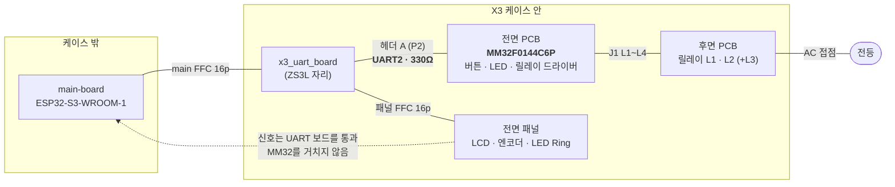

# 아키텍처 — X3 Thermostat 안에서 이 펌웨어의 위치

> 이 저장소는 **X3 전면 PCB의 MM32F0144C6P(U2)** 에 올라가는 펌웨어다.
> 상위 설계(집 전체 구성, 전원, PLC, 보드 발주) 중 **MM32가 맡는 범위만**
> 추려 펌웨어 관점으로 쓴 문서다.

## 1. 역할 변경 요약

원래 X3는 MM32 한 개가 LCD·엔코더·버튼·LED·릴레이를 전부 쥐고 Zigbee 모듈(ZS3L)과
UART로 대화하는 구조였다. X3 Thermostat에서는 **ZS3L 자리에 `x3_uart_board`를 꽂아
ESP32-S3(main-board)를 연결**하고, 전면 패널 FFC를 CON1에서 빼서 그 보드로 옮긴다.

결과적으로 MM32의 역할은 **ESP32-S3의 I/O 서브컨트롤러**로 축소된다.

| 입출력 | 담당 | 비고 |
|---|---|---|
| 버튼 K1~K4 | **MM32** | 전면 PCB 직결, 변화 없음 |
| 버튼 LED K1~K4 (bi-color) + LED_EN | **MM32** | 전면 PCB 직결, 변화 없음 |
| 릴레이 L1~L4 | **MM32** | 전면 드라이버 4채널 그대로. 후면 릴레이는 큰방 L1~L3, 나머지 L1~L2 |
| MM32 ↔ ESP32-S3 | **MM32** | USART2 (PA2/PA3) — 이 펌웨어의 유일한 외부 인터페이스 |
| 원형 LCD (GC9A01A) | ESP32-S3 | 패널 FFC가 CON1 → `x3_uart_board` CN1로 이동 |
| 로터리 엔코더 | ESP32-S3 | 〃 |
| LED Ring + LCD 백라이트 | ESP32-S3 | 〃 |
| 온습도(AHT25) · PLC(보일러) · WiFi/MQTT | ESP32-S3 | MM32와 무관 |

**LCD·엔코더·LED Ring을 구동하던 MM32 핀은 빈 CON1 커넥터로 이어질 뿐이라 전기적으로
의미가 없다.** 해당 드라이버(`dev_lcd` · `dev_encoder` · `dev_led_ring`)는 2026-09-22에
펌웨어에서 제거했다 → [hardware.md](hardware.md) §3.

## 2. 보드 연결



MM32와 ESP32-S3 사이의 물리 경로는 UART 2선뿐이다.
`PA2(TX) → R6 120Ω → 헤더 A-2 → R2 330Ω → CN2-12`,
`PA3(RX) ← R10 120Ω ← 헤더 A-1 ← R1 330Ω ← CN2-4`.
직렬 저항 합이 450 Ω이라 오삽입·핫플러그 시 전류가 약 7 mA로 제한된다.

## 3. 소프트웨어 책임 분할

**MM32 (이 펌웨어)**

- 버튼 4개 스캔 + 디바운스 → 키 DOWN/UP 이벤트를 AT notify로 송신
- ESP32-S3가 보낸 AT 명령으로 릴레이 L1~L4, 버튼 LED 4채널, LED 레일 on/off와 밝기(PWM) 제어
- 버튼 LED의 흰색↔주황 점멸(`T`)을 채널별 주기로 자체 구동
- 자신이 가진 출력의 현재 상태 유지 및 조회 응답 (`AT+STATUS?`)
- 부팅 시 안전 상태(릴레이 전부 OFF, LED 주황)로 시작하고 `+READY` 통보

명령 규격은 [at-protocol.md](at-protocol.md)에 있다.

**ESP32-S3 (별도 저장소)**

- 정책 판단 전부 — 어느 키가 어느 전등을 토글하는지, 난방 상태를 어떻게 표시할지
- LCD·엔코더·LED Ring 구동
- MQTT(전등), PLC(보일러), AHT25(온습도)
- MM32에 AT 명령 송신 및 notify 수신

> **정책은 전부 ESP32-S3에 둔다.** MM32는 "키가 눌렸다"를 보고하고 "릴레이를 켜라"를
> 실행할 뿐, 키와 릴레이를 직접 연결하지 않는다. 큰방(전등 3개)과 다른 방(2개)의 버튼
> 배정 차이도 ESP32-S3 쪽 설정으로 흡수되어, **MM32 펌웨어는 3대가 완전히 동일**하다.

## 4. 데이터 흐름

**사용자가 K3를 누름**

```
K3 tact ─▶ MM32 디바운스 ─▶ "+KEY:..." notify ─▶ ESP32-S3
                                                    │ 정책 판단 (전등1 토글)
                        MM32 ◀─ "AT+RELAY=..." ─────┤
                          │                          └─▶ MQTT publish
                          ├─▶ 릴레이 L1 ON
                        MM32 ─▶ "+LED:..." 명령 수신 ─▶ 버튼 LED K3 = white
```

**MQTT로 외부에서 전등을 켬** — ESP32-S3가 `AT+RELAY`와 LED 명령을 보내고,
MM32는 그대로 실행한다. 키 입력 경로와 동일한 종착점이다.

## 5. 참고 문서

| 문서 | 내용 |
|---|---|
| [hardware.md](hardware.md) | MM32가 소유한 핀맵과 전기적 동작 |
| [at-protocol.md](at-protocol.md) | ESP32-S3 ↔ MM32 AT 명령 규격 |
